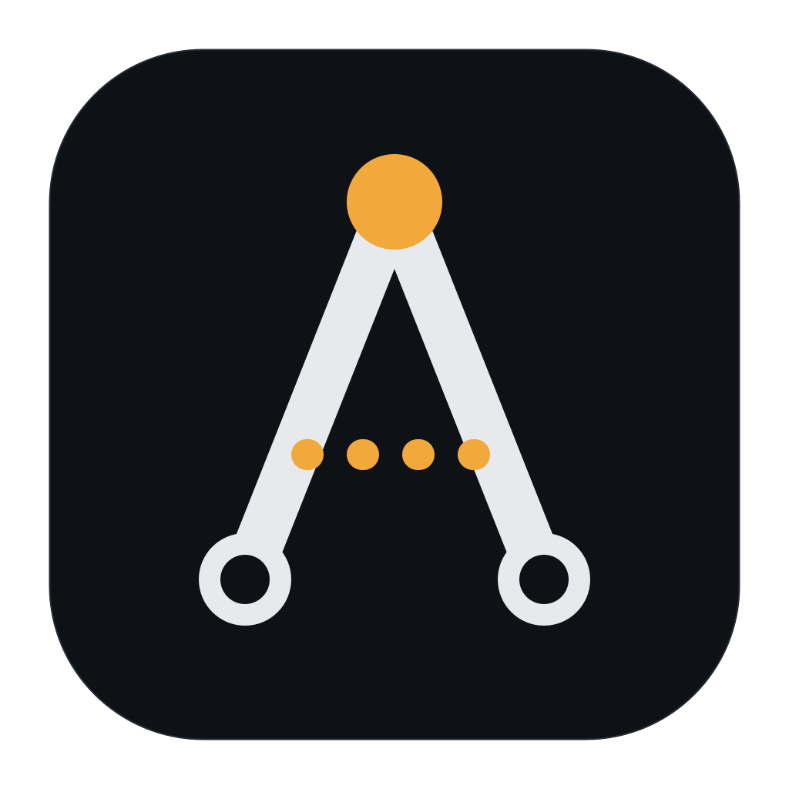
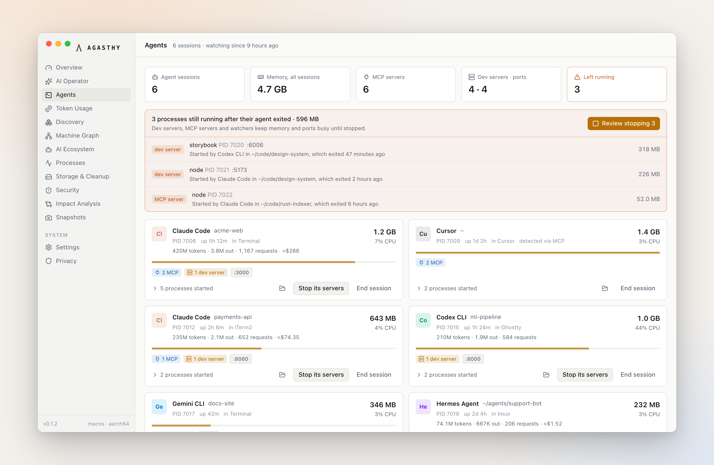
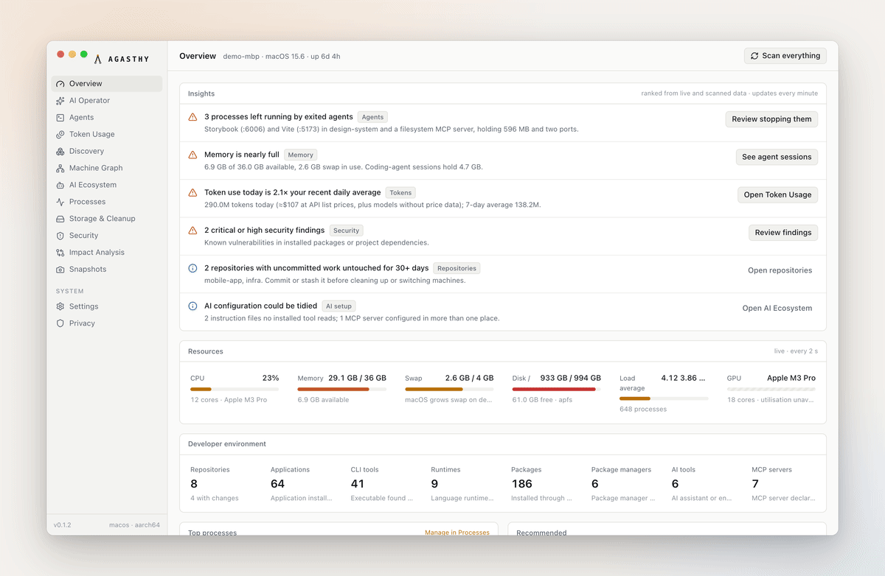
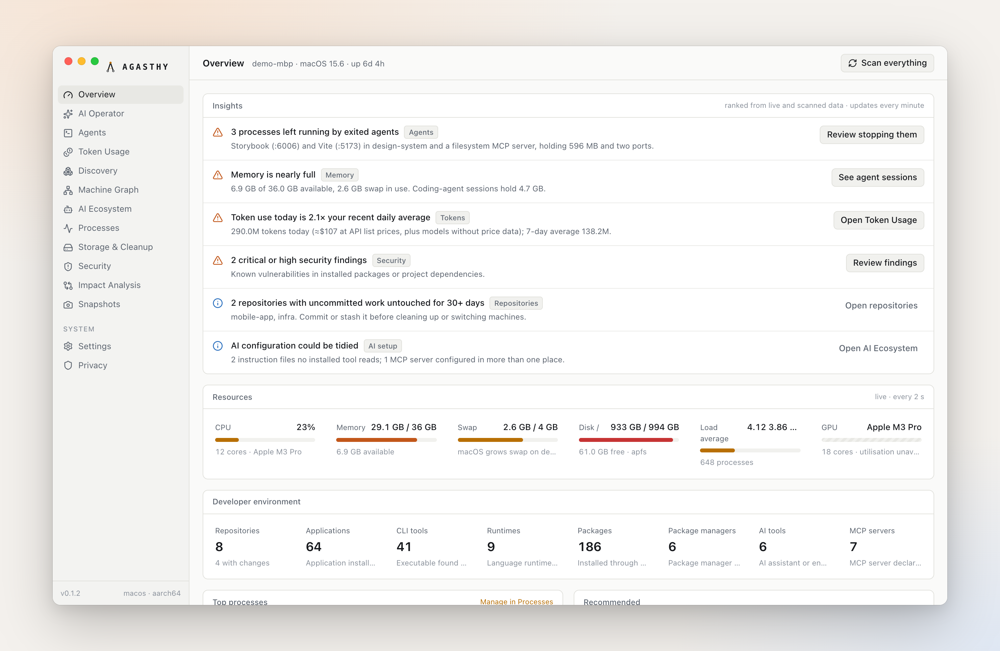
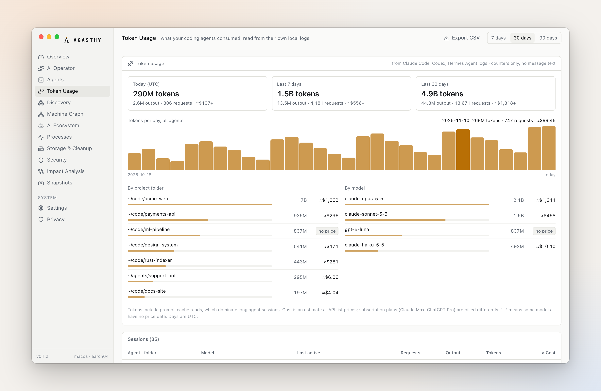
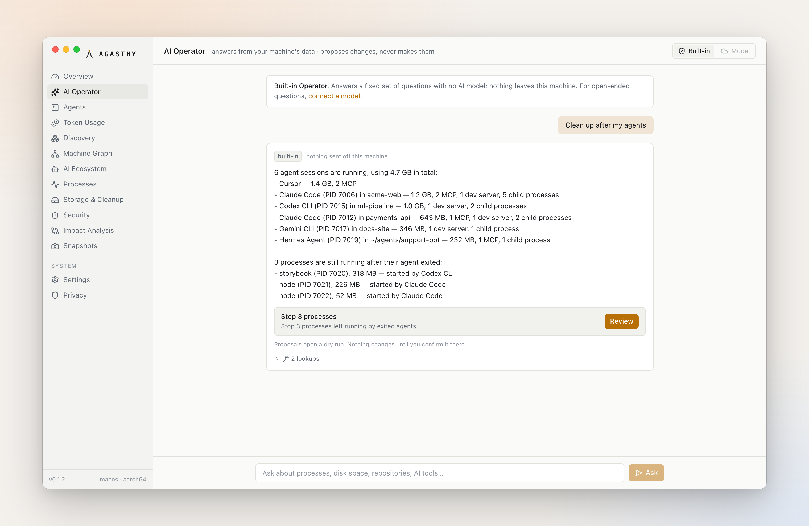
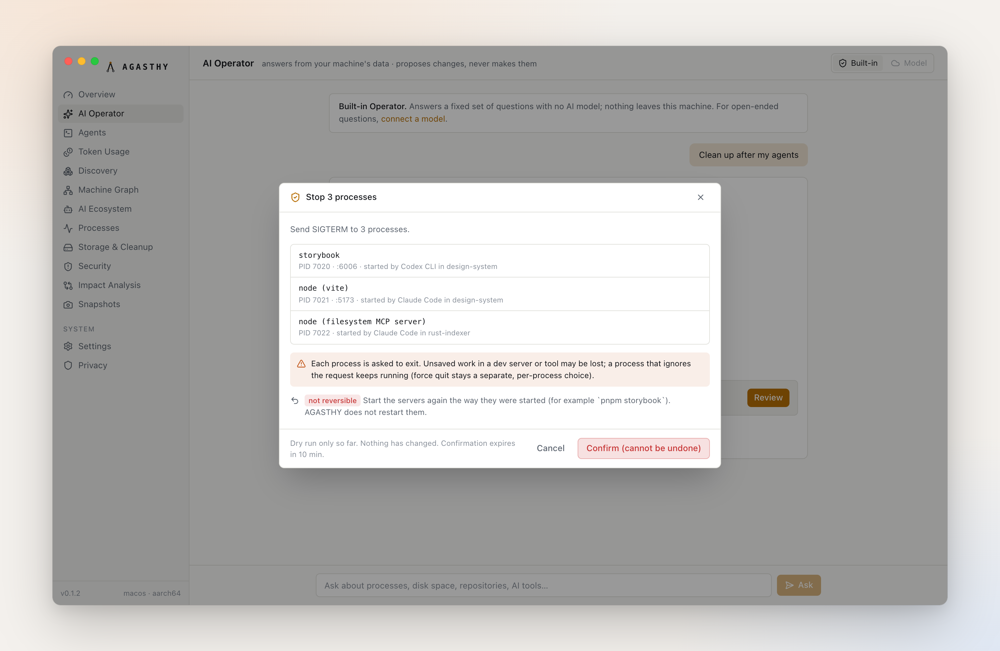
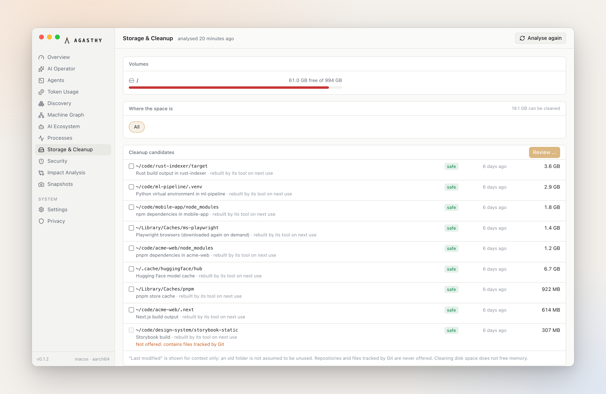
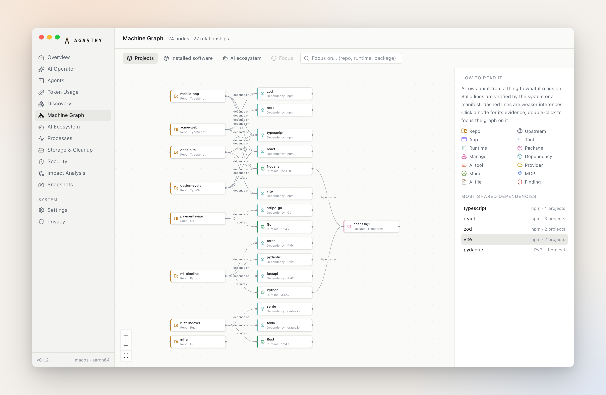

<p align="center">
  
</p>

<h1 align="center">AGASTHY</h1>

<p align="center"><strong>One intelligence layer for your developer machine.</strong></p>

<p align="center">
Every repo, runtime, package and AI tool on your machine, connected in a live knowledge graph.<br/>
Track coding agents and what they cost, see what breaks before you remove anything,<br/>
free disk space safely, and ask plain questions about your machine with evidence behind every answer.
</p>

<p align="center">
  <a href="https://github.com/HMAKT99/Agasthy/releases/latest"><strong>Download for Mac (Apple silicon)</strong></a> ·
  <a href="https://github.com/HMAKT99/Agasthy/releases/latest">Windows preview</a> ·
  Linux from source ·
  free and open source · no account · no telemetry
</p>

<p align="center">
  <picture>
    <source media="(prefers-color-scheme: dark)" srcset="docs/screenshots/agents-dark.png" />
    
  </picture>
</p>

---

## Why you'll want it

A developer machine holds hundreds of moving parts: cloned repositories, several copies of the same runtime, packages from six package managers, AI tools with their own configs, and now coding agents starting servers in every terminal. Nothing shows you how they connect, what they cost, or what is safe to remove. **AGASTHY reads the machine itself, links everything in one graph, and lets you act on it safely.**

| | |
|---|---|
| 📦 **Everything, discovered** | Repositories (branch, uncommitted work, remotes, duplicate clones), applications, CLI tools and runtimes (which copy is active, which are shadowed), and packages from Homebrew, npm, pnpm, uv, pip and cargo. Every fact carries its evidence. |
| 🕸️ **A knowledge graph of your machine** | Projects, runtimes, dependencies, packages, tools and AI configuration, linked. See which projects share a dependency and what relies on what. |
| 💥 **Impact analysis** | "What breaks if I remove this?" for any package, runtime or tool, simulated before you touch anything. Try dependency upgrades in an isolated Update Lab. |
| 🤖 **Coding agents, live** | Every Claude Code, Codex, Gemini CLI, Cursor, Aider, Hermes or OpenClaw session with its memory, ports, MCP and dev servers. When an agent exits and leaves a server running, AGASTHY says which session started it and stops it in one reviewed step. |
| 🪙 **Token spend** | Tokens, requests and estimated cost per day, session, project and model, from the agents' own local logs. Counters only, never your prompts. Export to CSV. |
| 🧠 **AI ecosystem** | Installed AI tools, providers, local models, MCP servers in every config, and instruction files (`CLAUDE.md`, `AGENTS.md`, rules) with duplicates, orphans and conflicts. |
| 💾 **Safe disk cleanup** | Rebuildable `node_modules`, `target`, virtualenvs, build output and caches. Only what Git ignores and nothing tracked, moved to a quarantine you can restore from. |
| 🛡️ **Security & snapshots** | Outdated packages, tools of unknown origin, opt-in vulnerability advisories. Snapshot your setup and get the commands to rebuild it on a new machine. |
| 💬 **Ask your machine** | "What is using my RAM?" · "Free 10 GB safely" · "Which repos haven't I touched in 90 days?" · "What breaks if I remove openssl@3?" Works with no AI model; optionally connect Ollama, LM Studio or a cloud model. |
| 🧭 **Insights + menu bar** | A ranked list of what needs attention right now (low disk, swap pressure, token spikes, stale data), one click away in the menu bar. |

## Built to be trusted

- **Local-first.** Everything stays in one SQLite file on your Mac. No account, no telemetry, no analytics.
- **Nothing changes without you.** Every action is a dry run first, shows exact targets and sizes, needs your confirmation, is checked afterwards and written to an audit log.
- **Hard limits.** It never uses `sudo`, never deletes Git repositories or tracked files, never touches Docker volumes, and never stops system or other users' processes. The AI can only *propose* actions; it cannot run commands.
- **Evidence, not guesses.** Every fact carries its source and a confidence level. Anything it cannot measure is shown as *unavailable*, never as 0.
- **Light.** About 0.4% CPU and under 100 MB for the app process in normal use; a 13 MB app.

## Install (macOS, Apple silicon)

1. Download the latest `AGASTHY-…-apple-silicon.dmg` from [Releases](https://github.com/HMAKT99/Agasthy/releases) (macOS 12 or later).
2. Open it and drag **AGASTHY** to **Applications**.
3. The first time, right-click AGASTHY in Applications and choose **Open**. Releases are not yet notarized by Apple, so macOS asks once. If macOS says the app is damaged, run `xattr -dr com.apple.quarantine /Applications/AGASTHY.app` and open it again.

AGASTHY lives in the menu bar as well as its window; closing the window keeps it running, and **Quit AGASTHY** is in the menu-bar menu. It offers new versions itself (signature-checked, installed only when you click **Install and restart**); this can be turned off in Settings → About.

### Windows (x64, preview)

Download `AGASTHY_…_x64-setup.exe` from [Releases](https://github.com/HMAKT99/Agasthy/releases) and run it. The installer is not code-signed yet, so Windows SmartScreen shows a warning: choose **More info → Run anyway**.

The preview is built and tested in CI on Windows but has not yet been used much on real Windows PCs; [please report](https://github.com/HMAKT99/Agasthy/issues/new) anything that looks wrong (Settings → About → **Report a problem** prepares the details). Known gaps on Windows: **Stop** for a process is not available (Force quit is), leftovers whose start AGASTHY did not see are not detected, and WinGet packages and GPU details are not shown.

Intel Macs and Linux are not released yet (see [Supported platforms](#supported-platforms)).

## Why it exists

A developer machine accumulates hundreds of components spread across directories, terminals and configuration files: cloned repositories, applications, CLI tools, several copies of the same runtime, packages from several package managers, and more. Answering simple questions, such as "which Python actually runs?", "what did Homebrew install?" or "which of my clones have uncommitted work?", means running a dozen commands.

AGASTHY reads the machine directly and keeps what it finds, plus the evidence behind each fact, in a local database.

## What works today (macOS)

| Area | What AGASTHY does |
|---|---|
| **Live resources** | CPU (total and per core), memory, swap, disk per volume, load average, process count, top processes by memory and CPU, GPU model. Anything it cannot measure is shown as *unavailable* with a reason, never as 0. |
| **Repositories** | In folders **you choose**: finds Git working trees and reports branch, HEAD commit, last commit time, working-tree status (staged / modified / untracked / conflicted), local branch count, remotes (credentials stripped), GitHub origin, languages, frameworks, licence, manifests, size on disk, and duplicate clones of the same project. |
| **Applications** | Bundles in `/Applications`, `~/Applications` and `/System/Applications`, read from `Info.plist`. |
| **CLI tools & runtimes** | A curated catalogue of about 75 developer tools. For each copy on PATH: version, which copy is active and which are shadowed, and how it was installed (for example, it resolves into a Homebrew keg). |
| **Packages** | Read-only inventories from Homebrew (formulae and casks), npm and pnpm globals, uv tools, pip (default `python3`) and `cargo install`. A missing or failing manager is reported as such, never as "0 packages". |
| **Provenance** | Every fact carries evidence and a confidence level (*verified*, *strong*, *probable*, *unknown*). A Git remote read from the repository's own config is *verified*; an upstream taken from a Homebrew formula's homepage is *strong*. Nothing is guessed from names. |
| **Dependencies** | Reads `package.json`, `Cargo.toml`, `pyproject.toml`, `requirements.txt` and `go.mod` (including nested packages), with resolved versions from `package-lock.json`, `Cargo.lock` and `uv.lock`. Shows which dependencies your projects share. |
| **Runtime requirements & impact** | Links projects to the runtimes they declare (`engines.node`, `.nvmrc`, `requires-python`, `rust-version`, `go`, …). Answers *"what breaks if I remove this runtime?"*: for each project, whether it would break, fall back to another copy on PATH, or be unaffected, and what is unknown. Nothing is removed; it is a simulation. |
| **Machine Graph** | An interactive graph of projects, runtimes, dependencies, packages, binaries and upstream projects, with focus, depth and kind filters, search, and the evidence behind every edge. |
| **AI ecosystem** | Finds AI coding assistants, desktop AI apps and local inference engines from evidence on disk; the providers they use (with how strongly each is confirmed); MCP servers in every known config; local models; and AI instruction files (`CLAUDE.md`, `AGENTS.md`, Cursor/Copilot rules, agents, skills, commands) globally and per project, with duplicates, overlaps, orphans and potential conflicts. Credential files are only checked for existence and secrets are redacted. |
| **Processes** | Every process with CPU, memory, listening ports, the project it runs in, and why it is protected if it is. Stop or force-quit your own processes after a reviewed confirmation; system and other users' processes are refused. |
| **Storage & cleanup** | Measures dependency folders and build output in your projects (only those Git ignores and that contain no tracked files) and a fixed list of developer caches. You pick items, review a dry run, and they move to a quarantine you can restore from; space is freed when you delete them permanently. Docker build cache and dangling images can be pruned; volumes never are. |
| **Impact analysis** | "What if I remove X?" for packages, runtimes, dependencies, tools and apps: Homebrew packages that need it (from what installed kegs actually link to), executables and runtimes removed with it, and every project whose runtime would break or fall back, with unknowns and a suggested plan AGASTHY does not run. |
| **Safe Update Lab** | Try a dependency update (npm, pnpm, Cargo) in a separate Git worktree. Install and test steps run only when you approve them (install scripts off by default), and results are copied back only on request. |
| **Snapshots** | Record installed software, repositories (commit, branch, remote) and environment variable names; compare snapshots; list the commands that would bring back what is missing. Metadata only, not a backup. |
| **Security & lifecycle** | Outdated Homebrew packages, tools of unknown origin, and, if you opt in, OSV.dev advisories for npm, PyPI, crates.io and Go packages with exact versions. |
| **AI Operator** | Ask questions in plain language: *what is using my RAM*, *free 10 GB safely*, *which repos have I not touched in 90 days*, *which MCP servers are configured*, *what breaks if I remove openssl@3*. A built-in mode answers common questions with no AI model and sends nothing anywhere. Optionally connect a local model (Ollama, LM Studio, vLLM, LocalAI) or, after a separate opt-in, a cloud model (Anthropic, OpenAI, Gemini, OpenRouter, any OpenAI-compatible endpoint). The model can only read through AGASTHY's typed tools and *propose* changes; every proposal opens the same dry-run review as the rest of the app. |
| **Agents** | Every running coding-agent session (Claude Code, Codex, Gemini CLI, Cursor Agent, Aider, Hermes Agent, OpenClaw and more, plus any process that starts MCP servers) with its process tree, memory, ports and MCP/dev servers; what is still running after an agent exits, with one reviewed action to stop it; Git worktrees agents work in. |
| **Token Usage** | Tokens, requests and estimated cost per day, session, project folder and model, read from Claude Code and Codex logs and Hermes Agent's database. Counters only, never message text. |
| **Insights & menu bar** | A ranked list of what needs attention (low disk, swap pressure, processes agents left running, token spikes, stale data, security findings), and a menu-bar item with the same at a glance. |
| **Audit & privacy** | An append-only audit log of every action, and a privacy page listing exactly which programs AGASTHY may run. |

Repositories, installed packages, binaries on PATH and applications are kept as **separate kinds**. A local clone is never treated as installed software.

### Not built yet

Open items are listed in [ROADMAP.md](ROADMAP.md), notably validating the Windows and Linux adapters on real hardware. The app's sidebar shows only the sections that work.

## Tour

<p align="center"></p>

| | |
|---|---|
| <br/>**Insights.** What needs attention now, each with one action. | <br/>**Token Usage.** Tokens and estimated cost by day, project and model. |
| <br/>**Ask your machine.** Answers from real data; changes are only proposed. | <br/>**Nothing runs unreviewed.** Every change is a dry run you confirm. |
| <br/>**Safe cleanup.** Only rebuildable folders Git ignores, into a restorable quarantine. | <br/>**Machine Graph.** Projects, runtimes and dependencies, and what depends on what. |

<sub>Screenshots use a synthetic demo machine (`pnpm screenshots` regenerates them), not real data.</sub>

## Supported platforms

| Platform | Status |
|---|---|
| macOS 12+ (Apple Silicon) | Implemented and tested on macOS 15 / M2. |
| macOS (Intel) | Expected to work; not yet tested. |
| Windows 10/11 (x64) | **Preview.** Installer published with each release; built and tested in CI. Applications from the registry, Scoop, Chocolatey 2.x, npm/pnpm/uv/cargo, listening ports via `netstat`, agents and token usage. Not yet: graceful Stop (Force quit works), WinGet, GPU details. Feedback from real Windows PCs wanted. |
| Linux | **Unvalidated.** `.desktop` applications (including Flatpak and Snap), Flatpak and Snap packages, Homebrew/npm/pnpm/uv/pip/cargo, listening ports via `lsof`; unit-tested, not yet run on Linux. GPU information reports "unsupported". |

## Architecture

A Rust workspace with a thin Tauri 2 shell and a React UI:

```
apps/desktop/            React + TypeScript UI; src-tauri/ is a thin command layer
crates/core/             domain model, SQLite store (FTS5), migrations, audit log
crates/platform-adapters/ OS adapters (macOS / Windows / Linux) and the guarded command runner
crates/discovery/        read-only discovery: repositories, software, packages
crates/provenance/       remote-URL parsing, credential redaction, confidence rules
crates/graph/            graph views, shared dependencies, runtime impact analysis
crates/process-manager/  processes, listening ports, guarded termination
crates/cleanup/          disk analysis, cleanup safety checks, quarantine, Docker usage
crates/actions/          typed action engine: plan (dry run) → confirm → execute → verify → audit
crates/snapshots/        environment snapshots, comparison, reconstruction plans
crates/security/         outdated software, unknown provenance, opt-in OSV.dev advisories
crates/update-lab/       Git-worktree labs for trying dependency updates
crates/system-monitor/   CPU / memory / disk / process telemetry
crates/cli/              `agasthy` headless CLI (JSON output)
packages/shared-types/   TypeScript types generated from the Rust model (ts-rs)
packages/ui/             shared React components
migrations/              SQL schema
```

See [docs/architecture.md](docs/architecture.md) for the data model, safety boundaries and how to add a platform.

## Development setup

Requirements: Rust (stable, 1.90+), Node.js 20+, pnpm 10, and on macOS the Xcode Command Line Tools.

```sh
pnpm install
pnpm dev                 # runs the desktop app (Vite + Tauri)
```

Checks:

```sh
cargo fmt --all --check
cargo clippy --workspace --all-targets -- -D warnings
cargo test --workspace
pnpm typecheck && pnpm lint && pnpm test
pnpm e2e                 # Playwright UI tests (uses installed Chrome locally)
pnpm check:types         # generated TS types match the Rust model
```

Headless discovery (prints JSON, changes nothing):

```sh
cargo run -p agasthy-cli -- scan ~/code --depth 4
cargo run -p agasthy-cli -- software
cargo run -p agasthy-cli -- packages
cargo run -p agasthy-cli -- telemetry
cargo run -p agasthy-cli -- impact runtime:/usr/local/bin/python3 --db <file>
```

Build a DMG (unsigned unless Apple credentials are set; see [docs/releasing.md](docs/releasing.md)):

```sh
pnpm release:mac         # output: dist/AGASTHY-<version>-apple-silicon.dmg
```

Details: [docs/development.md](docs/development.md).

## Privacy

AGASTHY has no account, telemetry or analytics. Its only network requests are: an update check against this repository's GitHub Releases at start-up (can be turned off; sends nothing about your machine), OSV.dev advisory checks if you turn them on, and an AI model endpoint if you configure one (cloud models need a separate opt-in). The AI scan only checks whether local inference engines are listening on 127.0.0.1. It only looks for repositories in folders you add, stores results in a local SQLite file, and strips credentials from Git URLs before storing them. It runs external programs only from an allowlist, with fixed arguments and never through a shell. Full details: [docs/privacy.md](docs/privacy.md).

## Roadmap

Development is phased: foundation → MVP discovery → intelligence graph → AI ecosystem → system operations and safe cleanup → impact analysis, snapshots and security → AI operator and full Windows/Linux support. The live checklist is in [ROADMAP.md](ROADMAP.md).

## Contributing

Contributions are welcome. Please read [CONTRIBUTING.md](CONTRIBUTING.md) and [CODE_OF_CONDUCT.md](CODE_OF_CONDUCT.md). Report security issues as described in [SECURITY.md](SECURITY.md), not in public issues.

## Name

*AGASTHY* is the product name. A suggested backronym, not a historical meaning: **A**utonomous **G**overnance, **A**nalysis, **S**ystems, **T**ooling & **H**ybrid intelligence.

## License

Apache License 2.0. See [LICENSE](LICENSE).
